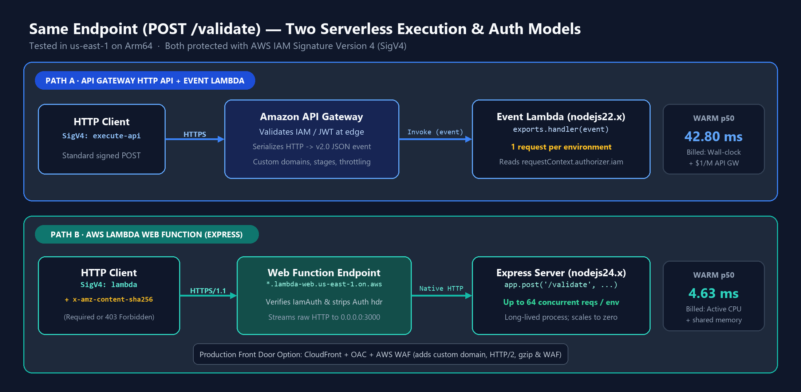
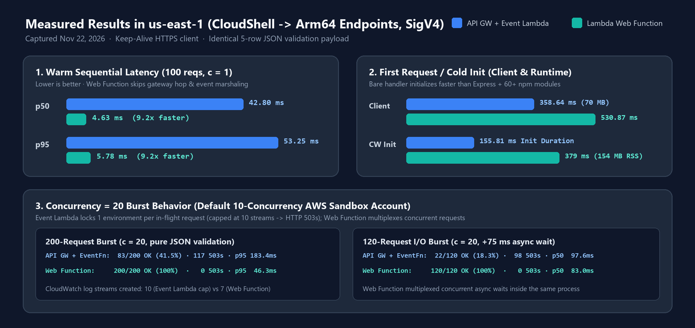
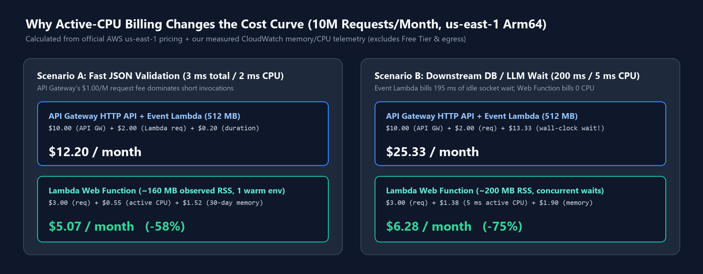

# With AWS Lambda Web Functions, When Do You Still Need API Gateway?

*Deploying the same IAM-protected Node.js API on both serverless patterns in `us-east-1`—side-by-side code, SigV4 authentication traps, benchmark numbers, and a practical decision matrix.*

---

On October 12, 2026, AWS launched **Lambda Web Functions**: a compute model that runs a standard Node.js (or Python) HTTP server directly on AWS Lambda with a built-in HTTPS endpoint, scaling to zero when idle and handling up to **64 concurrent requests per execution environment**.

For the past decade, exposing a small Node.js HTTP API on Lambda meant putting **Amazon API Gateway** (or a Lambda Function URL) in front of an **Event Function** (`exports.handler = async (event) => ...`), translating HTTP into a JSON event object, running one request per execution environment, and paying for wall-clock duration.

That raises an immediate architectural question: **If your workload is already an HTTP API, when should you switch to a Lambda Web Function—and when do you still need API Gateway in front?**

To answer that with real data instead of launch-blog summaries, I deployed the exact same synthetic JSON validation endpoint (`POST /validate`) both ways in **`us-east-1` on Arm64**, locked both down with **AWS IAM Signature Version 4 (SigV4)**, ran sequential and concurrent burst tests from AWS CloudShell, and inspected the raw CloudWatch telemetry.



---

## Core Hypothesis

Before running a single test, here was the hypothesis:

1. **Latency & concurrency:** Removing the API Gateway hop and serving multiple requests inside one already-listening Node.js HTTP process should cut warm latency and absorb concurrent I/O waits across fewer execution environments—at the cost of a slightly heavier cold start from loading a web framework.
2. **Cost:** Because Web Functions charge for **active CPU time** rather than wall-clock wait time (and skip API Gateway's `$1.00 / million` HTTP API fee), Web Functions should be materially cheaper for both fast JSON APIs and I/O-bound endpoints.
3. **Where API Gateway still wins:** Web Functions strip away the managed gateway layer—meaning authentication, custom domains, HTTP/2, response compression, per-client throttling, and WAF either move into your application code or require **Amazon CloudFront** in front.

Most of that hypothesis held—with **two sharp surprises** during live testing: a **SigV4 header rule** that silently turns valid signed requests into `403 Forbidden`, and a **concurrency quota cliff** that caused Path A to drop **58.5% of a 20-concurrency burst** on a default sandbox account while Path B served **100%**.

---

## Side-by-Side Implementation: Same Business Logic, Two Shapes

Both deployments run the exact same synthetic validation module (`validate.js`), which checks an array of `{ id, amount }` objects and returns invalid row numbers:

```javascript
// validate.js — shared identically between Path A and Path B
'use strict';

function validatePayload(payload) {
  const rows = payload?.rows;
  if (!Array.isArray(rows)) {
    return { statusCode: 400, body: { error: 'rows must be an array' } };
  }

  const invalidRows = [];
  for (let i = 0; i < rows.length; i++) {
    const row = rows[i];
    const validId = typeof row?.id === 'string' && row.id.trim().length > 0;
    const validAmount =
      typeof row?.amount === 'number' && Number.isFinite(row.amount) && row.amount > 0;
    if (!validId || !validAmount) invalidRows.push(i + 1);
  }

  return {
    statusCode: 200,
    body: { rowCount: rows.length, invalidCount: invalidRows.length, invalidRows }
  };
}

module.exports = { validatePayload };
```

### Path A: API Gateway HTTP API + Event Lambda

In the established pattern, your code does not open a socket. API Gateway terminates HTTPS, validates IAM credentials, serializes the HTTP request into a Payload Format 2.0 JSON event, and invokes `exports.handler`:

```javascript
// apigw-fn/index.js — Event Lambda handler (1 request at a time per environment)
'use strict';
const { validatePayload } = require('./validate');

let envInvocations = 0;

exports.handler = async (event) => {
  envInvocations += 1;

  let parsedBody = {};
  if (event.body) {
    try {
      const raw = event.isBase64Encoded
        ? Buffer.from(event.body, 'base64').toString('utf8')
        : event.body;
      parsedBody = JSON.parse(raw);
    } catch {
      return {
        statusCode: 400,
        headers: { 'content-type': 'application/json' },
        body: JSON.stringify({ error: 'Invalid JSON body' })
      };
    }
  }

  const result = validatePayload(parsedBody);
  return {
    statusCode: result.statusCode,
    headers: { 'content-type': 'application/json' },
    body: JSON.stringify({
      ...result.body,
      meta: {
        pattern: 'apigw-event-lambda',
        arch: process.arch,
        envInvocations,
        iamCallerPresent: Boolean(event.requestContext?.authorizer?.iam)
      }
    })
  };
};
```

Standing up Path A cleanly requires **six CloudFormation resources** (`AWS::IAM::Role`, `AWS::Lambda::Function`, `AWS::ApiGatewayV2::Api`, `Integration`, `Route`, `Stage`, and `AWS::Lambda::Permission`):

```yaml
# apigw-template.yaml (abridged key resources)
Resources:
  ValidateFunction:
    Type: AWS::Lambda::Function
    Properties:
      FunctionName: cb-speedrun-apigw-fn
      Runtime: nodejs22.x
      Architectures: [arm64]
      Handler: index.handler
      MemorySize: 512
      Role: !GetAtt ValidateFunctionRole.Arn
      Code: { S3Bucket: !Ref CodeBucket, S3Key: !Ref CodeKey }

  HttpApi:
    Type: AWS::ApiGatewayV2::Api
    Properties:
      Name: cb-speedrun-http-api
      ProtocolType: HTTP

  LambdaIntegration:
    Type: AWS::ApiGatewayV2::Integration
    Properties:
      ApiId: !Ref HttpApi
      IntegrationType: AWS_PROXY
      IntegrationUri: !GetAtt ValidateFunction.Arn
      PayloadFormatVersion: '2.0'

  ValidateRoute:
    Type: AWS::ApiGatewayV2::Route
    Properties:
      ApiId: !Ref HttpApi
      RouteKey: POST /validate
      AuthorizationType: AWS_IAM
      Target: !Sub integrations/${LambdaIntegration}
```

### Path B: AWS Lambda Web Function (Express Server)

With a Web Function, there is no event wrapper. Your application starts an ordinary HTTP server listening on `process.env.AWS_LAMBDA_HTTP_ENDPOINT` (`0.0.0.0:3000` inside Lambda, falling back to `127.0.0.1:3000` locally):

```javascript
// web-fn/index.js — Standard Express server (serves concurrent requests per environment)
'use strict';
const express = require('express');
const { validatePayload } = require('./validate');

const app = express();
app.disable('x-powered-by');
app.use(express.json({ limit: '1mb' }));

let envRequestsServed = 0;
let activeInFlight = 0;
let peakInFlightObserved = 0;

app.post('/validate', async (req, res) => {
  envRequestsServed += 1;
  activeInFlight += 1;
  if (activeInFlight > peakInFlightObserved) peakInFlightObserved = activeInFlight;

  try {
    const result = validatePayload(req.body);
    res.status(result.statusCode).json({
      ...result.body,
      meta: {
        pattern: 'lambda-web-function',
        arch: process.arch,
        envRequestsServed,
        peakInFlightObserved,
        authHeaderPresent: Boolean(req.headers.authorization)
      }
    });
  } finally {
    activeInFlight -= 1;
  }
});

const [host, port] = (process.env.AWS_LAMBDA_HTTP_ENDPOINT || '127.0.0.1:3000').split(':');
app.listen(Number(port), host, () => {
  console.log(`Web Function listening on ${host}:${port}`);
});
```

> **Critical concurrency rule:** Because one Web Function execution environment handles up to **64 concurrent HTTP requests** on the same Node.js event loop, never store user identity, tenant IDs, or request state in module-level globals. Keep per-request state on `req` / `res.locals` or `AsyncLocalStorage`, and always deploy with `NODE_ENV=production` so Express caches view/route internals and suppresses stack traces on unhandled errors.

Deploying Path B took **one CLI command** (`aws-cli/2.41.0`) and finished in **24 seconds** (versus **66 seconds** for the Path A S3 upload + CloudFormation stack):

```bash
cd web-fn && npm install --omit=dev
aws lambda-web deploy \
  --name cb-speedrun-web-fn \
  --code . \
  --create \
  --auth-type IamAuth \
  --env NODE_ENV=production \
  --region us-east-1
```

Captured deploy output (account and endpoint IDs masked):

```json
{
  "functionArn": "arn:aws:lambda:us-east-1:<ACCOUNT_ID>:web-function/cb-speedrun-web-fn",
  "endpointUrl": "<ENDPOINT_ID>.<SHARD>.lambda-web.us-east-1.on.aws",
  "roleArn": "arn:aws:iam::<ACCOUNT_ID>:role/awscli-lambdaweb-cb-speedrun-web-fn",
  "bucketName": "awscli-lambdaweb-<ACCOUNT_ID>-us-east-1-an",
  "objectKey": "lambda-web/cb-speedrun-web-fn/20261122T132702Z-2d418bf6.zip"
}
```

> **Deployment sharp edge #1 — `Active` does not mean listening:** In `LatestRevision` auto-deployment mode, Lambda shifts traffic and marks a revision `Active` *without* gating on whether your HTTP server actually bound `0.0.0.0:3000`. Always verify two things after every deploy: (1) an actual HTTP request to your endpoint, and (2) `platform.initReport` in `/aws/lambda/web/<function-name>` showing `"status": "success"`.

---

## Authentication in Practice: Where the Two Paths Diverge Immediately

Authentication is where "just run Express on Lambda" meets production reality.

API Gateway HTTP APIs offer **three managed front-door options** before your code ever executes: `AWS_IAM`, native **JWT Authorizers** (OIDC / Cognito), and **Lambda Authorizers**.

Lambda Web Functions offer **only two endpoint modes**:
1. **`IamAuth`** — Private to IAM principals granted `lambda:InvokeWebFunctionEndpoint` (signed with SigV4 for regional endpoints, or **SigV4a** with region set `*` for `MultiRegion` endpoints).
2. **`ApplicationManaged`** — **Public on the internet.** Every request hits your Express server directly; your code owns JWT verification, session cookies, API keys, and per-client rate limiting.

### What Happened When We Tested `IamAuth` vs. `AWS_IAM`

I configured both endpoints for IAM authentication and ran four live checks from CloudShell:

| Auth Test Case | API Gateway (`AWS_IAM`) | Lambda Web Function (`IamAuth`) | Why It Happened |
| :--- | :--- | :--- | :--- |
| **1. Unsigned `POST /validate`** | `403 Forbidden` | `403 Forbidden` | Both block unauthenticated internet callers before invoking user code. |
| **2. SigV4 service name** | `execute-api` | `lambda` | Calling a Web Function signed for `execute-api` fails signature verification. |
| **3. Valid SigV4 *without* `x-amz-content-sha256` header** | `200 OK` | **`403 Forbidden`** | **Gotcha:** Web Functions don't hash the body during auth; they *require* `x-amz-content-sha256` (either the SHA-256 hex digest or `UNSIGNED-PAYLOAD`) on every request—even `GET`s with an empty body. |
| **4. What reaches your code?** | `event.requestContext.authorizer.iam` (`true`) | `req.headers.authorization` is **`undefined`** (`false`) | Lambda strips the `AWS4-HMAC-SHA256` `Authorization` header after verifying it! |

Here is the exact `curl` difference if you want to smoke-test both from a terminal (requires `curl >= 7.75`):

```bash
# Path A — API Gateway HTTP API (service: execute-api)
curl --aws-sigv4 "aws:amz:us-east-1:execute-api" \
  --user "$AWS_ACCESS_KEY_ID:$AWS_SECRET_ACCESS_KEY" \
  -H "x-amz-security-token: $AWS_SESSION_TOKEN" \
  -H "content-type: application/json" \
  -d '{"rows":[{"id":"A-101","amount":125.5},{"id":"","amount":0}]}' \
  "https://<API_ID>.execute-api.us-east-1.amazonaws.com/validate"

# Path B — Lambda Web Function (service: lambda + mandatory x-amz-content-sha256!)
BODY='{"rows":[{"id":"A-101","amount":125.5},{"id":"","amount":0}]}'
PAYLOAD_HASH=$(printf '%s' "$BODY" | sha256sum | awk '{print $1}')

curl --aws-sigv4 "aws:amz:us-east-1:lambda" \
  --user "$AWS_ACCESS_KEY_ID:$AWS_SECRET_ACCESS_KEY" \
  -H "x-amz-security-token: $AWS_SESSION_TOKEN" \
  -H "x-amz-content-sha256: $PAYLOAD_HASH" \
  -H "content-type: application/json" \
  -d "$BODY" \
  "https://<ENDPOINT_ID>.<SHARD>.lambda-web.us-east-1.on.aws/validate"
```

**What if you have browser/mobile callers with JWTs AND want WAF protection?**
On API Gateway, you attach a native JWT Authorizer + custom domain. On Web Functions, the production pattern is **CloudFront + AWS WAF + Origin Access Control (`OriginAccessControlOriginType: lambda`, `SigningBehavior: always-amz-auth`)** in front of an **`IamAuth`** Web Function endpoint. CloudFront signs the origin hop with SigV4 while forwarding your viewer's Bearer JWT in `Authorization` (Lambda only strips `Authorization` values starting with `AWS4-`).

---

## Live Benchmark Results (`us-east-1`, Arm64)

All tests ran on November 22, 2026 from AWS CloudShell in `us-east-1` against both `us-east-1` endpoints over a persistent HTTPS keep-alive pool using the same 5-row payload (`rowCount: 5, invalidCount: 2, invalidRows: [3, 4]`).



### Summary of Captured Measurements

| Test Scenario | Metric | API Gateway + Event Lambda | Lambda Web Function | Observed Takeaway |
| :--- | :--- | :--- | :--- | :--- |
| **Cold / First Signed Hit** | Client end-to-end | **358.64 ms** | 530.87 ms | Bare handler starts faster than Express + 60+ npm modules. |
| **CloudWatch Init Telemetry** | Runtime init & RSS | `155.81 ms` init · `70 MB` max mem | `379 ms` init (`298 ms` CPU) · `154 MB` mem | Express doubles memory footprint (`154–158 MB` vs `70 MB`). |
| **Warm Sequential (`100` reqs, `c=1`)** | **p50 / p95 / p99** | `42.80 ms` / `53.25 ms` / `54.57 ms` | **`4.63 ms` / `5.78 ms` / `17.95 ms`** | **9.2x lower warm p50 & p95** without the gateway hop + event marshaling. |
| **CPU-Light Burst (`200` reqs, `c=20`)** | Success & p50 / p95 | `83/200` OK (**117 `503`s**) · `41.35` / `183.36 ms` | **`200/200` OK (100%)** · **`8.61` / `46.34 ms`** | Default 10-concurrency account cap choked Event Lambda (`10` streams vs `7`). |
| **I/O-Wait Burst (`120` reqs, `c=20`, `+75 ms` wait)** | Success & p50 / p95 | `22/120` OK (**98 `503`s**) · `97.59` / `103.68 ms` | **`120/120` OK (100%)** · **`83.01` / `98.58 ms`** | Web Function multiplexed concurrent waits (`~8 ms` overhead above `75 ms` sleep). |

### Three Things the Telemetry Revealed

#### 1. Warm latency dropped from `42.80 ms` to `4.63 ms` (p50)
Once warm, the Event Lambda's internal execution was fast—CloudWatch `REPORT` lines showed `Duration: 1.76 ms – 4.10 ms` (`Billed Duration: 2 – 5 ms`). Yet callers still paid **~38 ms of round-trip overhead** through API Gateway HTTP API routing, SigV4 evaluation, and event proxy serialization. Hitting the Web Function's native HTTP endpoint over keep-alive averaged **`5.00 ms`** (`p50: 4.63 ms`, `p95: 5.78 ms`).

#### 2. Why API Gateway + Event Lambda threw `117` HTTP `503`s at `c = 20` (and why fairness matters here)
Newer and sandbox AWS accounts start with a **10 concurrent execution quota** on Event Lambda functions. Because Event Functions lock **one execution environment per in-flight request**, firing 20 concurrent requests immediately maxed out at **10 CloudWatch log streams**, and API Gateway rejected the overflow with `503 Service Unavailable`—worsening to **81.7% failures (`98/120`)** when each request waited `75 ms` on simulated I/O.

*Important context:* In a production account with a standard 1,000+ concurrency limit, Event Lambda would **not** throw `503`s at `c = 20`—it would spin up 20 parallel execution environments. Even so, the architectural lesson is real: **Event Lambda scales environments linearly with `concurrency × I/O wait time`, whereas Web Functions share environments across concurrent requests** (serving all 200 burst requests with zero errors across 7 streams, and multiplexing concurrent `75 ms` waits inside a single Node.js process).

#### 3. Built-in JSON observability (and two protocol caveats)
Without installing `pino` or `winston`, every Web Function log line arrived in `/aws/lambda/web/cb-speedrun-web-fn` as structured JSON, alongside automatic `platform.initReport` telemetry:

```json
{
  "timestamp": "2026-11-22T13:28:36.816Z",
  "level": "INFO",
  "type": "platform.initReport",
  "region": "us-east-1",
  "record": {
    "status": "success",
    "revisionId": "rev-ejkc0",
    "initializationType": "native-http",
    "metrics": {
      "totalDurationMs": 379.0,
      "totalCpuTimeMs": 298.0,
      "maxMemoryUsageMb": 154
    }
  }
}
```

Two protocol details we also verified on the wire:
* **HTTP/1.1 only on the managed domain:** Both endpoints negotiated `httpVersion: "1.1"`. Web Function domains do not negotiate HTTP/2 or HTTP/3 directly; put CloudFront in front if browsers multiplex parallel requests.
* **No automatic response compression:** `contentEncoding` came back `none`. Web Functions ignore `Accept-Encoding` unless you add `app.use(compression())` in Express or enable CloudFront edge compression.
* **No X-Ray daemon wired in yet:** `_X_AMZN_TRACE_ID` is not populated in Web Function environments today; correlate using the injected `requestId` field in JSON logs and the `lambda-web-request-id` response header (confirmed `true` in our test).

---

## Cost Breakdown: Published `us-east-1` Rates + Measured Telemetry

Using official `us-east-1` Arm64 pricing (excluding Free Tier and data transfer) combined with our observed CloudWatch memory (`70 MB` on 512 MB Event Lambda vs. `~158 MB` consumed RSS on Web Functions):

* **API Gateway HTTP API + Event Lambda (512 MB Arm64):** `$1.00 / 1M` HTTP API requests + `$0.20 / 1M` Lambda requests + `$0.0000133334 / GB-second` billed on **wall-clock duration**.
* **Lambda Web Functions (Arm64):** `$0.30 / 1M` requests + `$0.0000276944 / active vCPU-second` + `$0.0000036667 / consumed GB-second` (memory accrues while an execution environment stays alive, shared across concurrent requests).



| Workload (10M reqs/month, steady traffic) | API Gateway + Event Lambda | Lambda Web Function | Monthly Delta |
| :--- | :--- | :--- | :--- |
| **Scenario A: Fast JSON API** (`3 ms` wall-clock, `2 ms` active CPU, 1 warm WebFn env @ `0.16 GB`) | `$10.00` (API GW) + `$2.00` (req) + `$0.20` (compute) = **`$12.20`** | `$3.00` (req) + `$0.55` (CPU) + `$1.52` (30d mem) = **`$5.07`** | **58% cheaper** (avoids `$1/M` gateway fee) |
| **Scenario B: Downstream DB/LLM Wait** (`200 ms` total, `5 ms` active CPU, `0.20 GB` RSS) | `$10.00` (API GW) + `$2.00` (req) + `$13.33` (idle wait!) = **`$25.33`** | `$3.00` (req) + `$1.38` (CPU) + `$1.90` (30d mem) = **`$6.28`** | **75% cheaper** (0 CPU billed during 195 ms I/O wait) |

*Note on spiky/idle traffic:* When traffic drops to zero, Web Functions scale environments to zero so memory billing stops too. Conversely, if traffic is trickle-sparse (e.g., 1 request every 2 minutes keeping an environment warm all month for only 20,000 requests), Event Lambda's per-millisecond billing costs pennies while a perpetually warm Web Function environment costs `~$1.50/month` in idle memory.

---

## Decision Matrix: When Do You Still Need API Gateway?

| Architectural Question | Choose Lambda Web Functions | Keep API Gateway + Event Lambda | Measured Takeaway from Our Build |
| :--- | :--- | :--- | :--- |
| **App shape & portability** | Existing Express / Fastify / Hono apps, SSR, or multi-route services you run locally as an HTTP server. | Single-purpose handlers or event-driven functions shared with SQS / EventBridge. | Zero event-wrapper boilerplate on Web Functions; `aws lambda-web deploy` shipped in **24s vs. 66s**. |
| **Warm latency & streaming** | Latency-sensitive JSON APIs, SSE, or multi-second LLM token streaming. | Standard CRUD APIs where `40–55 ms` warm latency meets SLAs. | Web Functions hit **`4.63 ms` warm p50** vs. **`42.80 ms`** through API Gateway (**9.2x faster**). |
| **Downstream I/O wait & burst concurrency** | High I/O wait (DB queries, external APIs, LLMs) where requests mostly `await` network responses. | Strict per-request memory/process isolation (untrusted payloads or mutable legacy globals). | One Web Function process multiplexes concurrent waits and bills **0 active CPU** while waiting. |
| **Authentication & authorization** | Internal SigV4 callers (`IamAuth`) or apps that already own JWT/session middleware (`ApplicationManaged`). | Edge-enforced OIDC/Cognito **JWT Authorizers**, API keys, usage plans, or request validation before compute runs. | Remember: Web Function `IamAuth` requires **`x-amz-content-sha256`** and strips `Authorization`. |
| **Custom domains, HTTP/2 & WAF** | You're happy fronting the endpoint with **CloudFront + OAC + AWS WAF** (which solves domain, HTTP/2, gzip, and WAF in one step). | You want a native regional custom domain (`api.example.com`), stage variables, or direct AWS WAF attachment without CloudFront. | Web Function domains are **HTTP/1.1 only**, uncompressed by default, and have no built-in custom domain. |
| **Multi-region active-active** | Built-in `MultiRegion` / `PerRegion` endpoints (`*.lambda-web.global.on.aws`) with automatic Route 53 latency routing and centralized logs. | Multi-region requires custom Route 53 health checks + regional API Gateway stacks + ACM certs per region. | Note: `MultiRegion` Web Function endpoints require `autoDeploymentMode: Disabled` and explicit revision weights. |

---

## Cleanup (Don't Leave Test Endpoints Running)

Web Function endpoints in `ApplicationManaged` mode are public on the internet, and warm environments accrue memory charges while receiving traffic. Tear down all test resources when finished:

```bash
# 1. Delete Web Function endpoint, function, CLI IAM role, and log groups
aws lambda-web delete-web-function-endpoint \
  --function-name cb-speedrun-web-fn --endpoint-name dev --region us-east-1
aws lambda-web delete-web-function \
  --function-name cb-speedrun-web-fn --region us-east-1
aws logs delete-log-group --log-group-name /aws/lambda/web/cb-speedrun-web-fn --region us-east-1
aws logs delete-log-group --log-group-name /aws/lambda/web/cb-speedrun-web-fn.local --region us-east-1

# 2. Delete API Gateway + Event Lambda CloudFormation stack, S3 bucket, and logs
aws cloudformation delete-stack --stack-name cb-speedrun-apigw-stack --region us-east-1
aws s3 rb s3://cb-speedrun-artifacts-<ACCOUNT_ID>-us-east-1 --force --region us-east-1
aws logs delete-log-group --log-group-name /aws/lambda/cb-speedrun-apigw-fn --region us-east-1
```

---

## Bottom Line

Lambda Web Functions do **not** make API Gateway obsolete—they make API Gateway **optional when all you needed was an HTTPS socket in front of a web framework**.

* **Default to Lambda Web Functions** when you are building or migrating an Express/Fastify/Hono HTTP server, streaming responses, serving I/O-heavy routes (DB/LLM calls), or deploying multi-region HTTP endpoints—and pair it with **CloudFront + OAC + WAF** when going to production on a custom domain.
* **Keep API Gateway** when you want AWS—not your Express middleware—to enforce JWT/Lambda authorizers, per-client usage plans and API keys, OpenAPI contracts, non-Lambda service integrations, or regional custom domains without managing a CDN distribution.

---

### References

1. [Announcing AWS Lambda Web Functions (AWS News Blog, Oct 12, 2026)](https://aws.amazon.com/blogs/aws/announcing-aws-lambda-web-functions-for-fast-consistent-web-app-performance-anywhere/)
2. [AWS Lambda Web Functions — Developer Guide](https://docs.aws.amazon.com/lambda/latest/dg/web-functions.html)
3. [Lambda Web Function Endpoint Access Control (`IamAuth`, `x-amz-content-sha256`, CloudFront OAC)](https://docs.aws.amazon.com/lambda/latest/dg/web-functions-endpoint-access-control.html)
4. [Testing Lambda Web Functions](https://docs.aws.amazon.com/lambda/latest/dg/web-functions-testing.html)
5. [AWS Lambda Pricing (Event Functions & Web Functions)](https://aws.amazon.com/lambda/pricing/)
6. [Create AWS Lambda Proxy Integrations for HTTP APIs in Amazon API Gateway](https://docs.aws.amazon.com/apigateway/latest/developerguide/http-api-develop-integrations-lambda.html)
