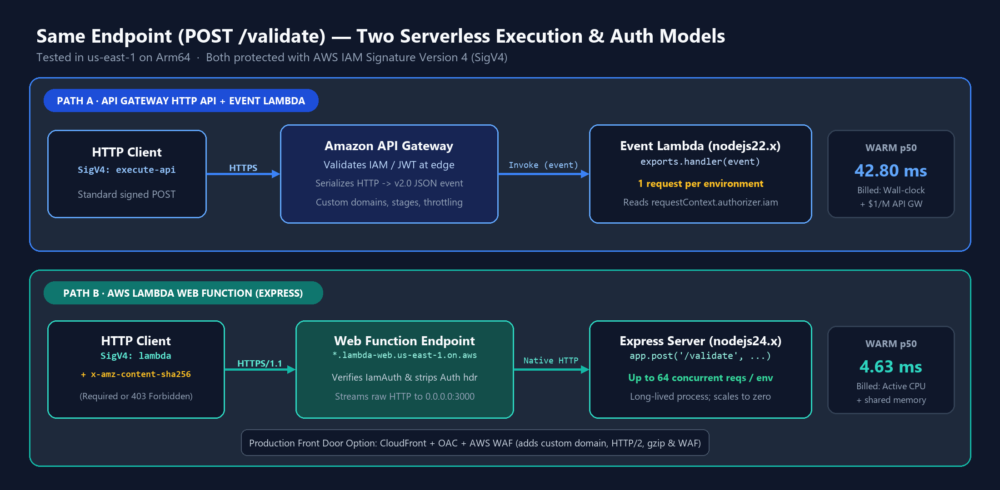
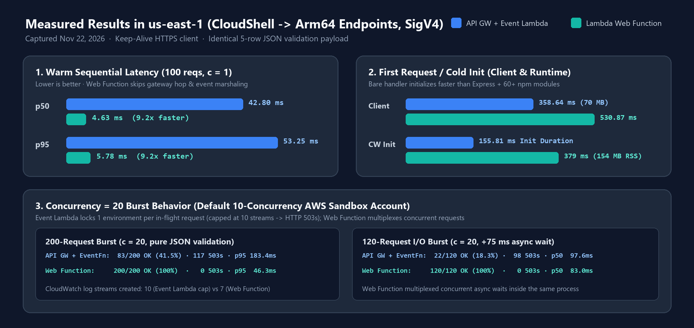

# AWS Lambda Web Functions vs. Amazon API Gateway + Event Lambda

Companion implementation, AWS CloudShell benchmark harness, sanitized CloudWatch telemetry, and full article comparing **AWS Lambda Web Functions** (`nodejs24.x`, Express) with **Amazon API Gateway HTTP API + Event Lambda** (`arm64`) using the same IAM SigV4-protected Node.js validation API in `us-east-1`.



## Key Findings (`us-east-1`, Arm64)

- **Warm sequential latency (`100` reqs, `c = 1`):** `4.63 ms` p50 (`5.78 ms` p95) on **Lambda Web Functions** vs. `42.80 ms` p50 (`53.25 ms` p95) on **API Gateway HTTP API + Event Lambda** (**9.2x faster**).
- **Cold init trade-off:** Bare Event Lambda initialized faster (`155.81 ms` init / `70 MB` max RAM / `358.64 ms` client round-trip) than Express on a Web Function (`379 ms` `platform.initReport` / `154–158 MB` RSS / `530.87 ms` client round-trip).
- **IAM SigV4 gotchas on Web Functions (`IamAuth`):**
  1. Sign for service **`lambda`** (not `execute-api`), with IAM action `lambda:InvokeWebFunctionEndpoint`.
  2. Every request **must** include **`x-amz-content-sha256`** (hex SHA-256 or `UNSIGNED-PAYLOAD`), even empty-body `GET`s—omitting it returns `403 Forbidden`.
  3. Lambda **strips the `Authorization` header** after verifying `AWS4-HMAC-SHA256` before forwarding to Express.
- **Multi-request concurrency (`c = 20`):** A single Web Function environment multiplexes up to 64 concurrent requests (and bills **0 active CPU** during downstream I/O waits), whereas Event Lambda locks 1 execution environment per in-flight request.



## Repository Layout

| Path | Description |
| :--- | :--- |
| [`ARTICLE.md`](./ARTICLE.md) | Full technical article with architecture, SigV4 examples, benchmark analysis, cost math, and decision matrix |
| [`lab/validate.js`](./lab/validate.js) | Shared synthetic JSON validation module used identically by both deployments |
| [`lab/web-fn-index.js`](./lab/web-fn-index.js) | **Path B:** Express HTTP server binding `AWS_LAMBDA_HTTP_ENDPOINT` for Lambda Web Functions |
| [`lab/apigw-handler.js`](./lab/apigw-handler.js) | **Path A:** API Gateway Payload v2.0 Lambda proxy handler |
| [`lab/apigw-template.yaml`](./lab/apigw-template.yaml) | **Path A:** CloudFormation template (`AWS::ApiGatewayV2::Api` + `AWS_IAM` route + Arm64 Lambda) |
| [`lab/benchmark.js`](./lab/benchmark.js) | Zero-dependency Node.js SigV4 benchmark runner (`execute-api` vs `lambda`) |
| [`lab/run-cloudshell-lab.sh`](./lab/run-cloudshell-lab.sh) | Turnkey 1-command AWS CloudShell runner (deploy both, benchmark, sanitize IDs, generate `cleanup.sh`) |
| [`lab/captured-evidence-sanitized.json`](./lab/captured-evidence-sanitized.json) | Sanitized telemetry & latency summary captured in `us-east-1` |
| [`assets/`](./assets/) | Architecture, benchmark, and `us-east-1` active-CPU vs. wall-clock billing diagrams (PNG + SVG) |

## Reproduce in AWS CloudShell (~5 Minutes)

1. Open **AWS CloudShell** in `us-east-1`.
2. Clone this repo and run the turnkey benchmark script:
   ```bash
   git clone https://github.com/hvmathan/lambda-web-functions-vs-api-gateway.git
   cd lambda-web-functions-vs-api-gateway
   chmod +x lab/run-cloudshell-lab.sh
   ./lab/run-cloudshell-lab.sh
   ```
3. Tear down all test resources immediately after inspecting the output:
   ```bash
   ~/cb-speedrun-lab/cleanup.sh
   ```

## License

MIT
